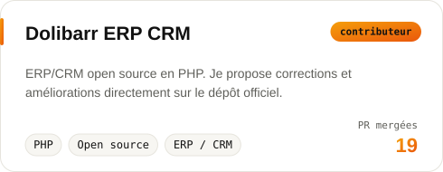
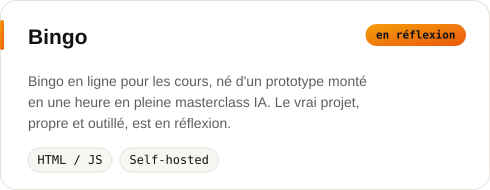
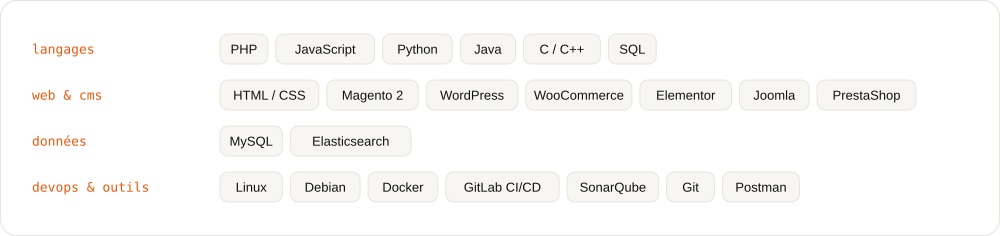
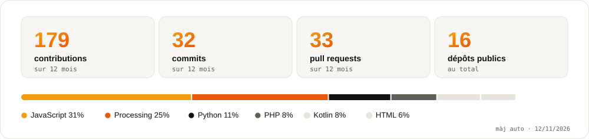

<picture>
  <source media="(prefers-color-scheme: dark)" srcset="assets/header-dark.svg">
  
</picture>

Développeur full stack et étudiant en **Master Expert en Développement Full Stack** à Ynov Bordeaux. Je travaille surtout côté PHP : e-commerce, CMS, modules sur mesure et moteurs de recherche. Le reste du temps, je bricole mon homelab : auto-hébergement, Linux et IA locale.

## Projets

<a href="https://github.com/Dolibarr/dolibarr/pulls?q=is%3Apr+author%3ALilianSonzogni">
  <picture>
    <source media="(prefers-color-scheme: dark)" srcset="assets/project-dolibarr-dark.svg">
    
  </picture>
</a>
<!-- Entourer d'un <a href="URL-DU-DEPOT"> quand le dépôt existera -->
<picture>
  <source media="(prefers-color-scheme: dark)" srcset="assets/project-bingo-dark.svg">
  
</picture>

## Stack

<picture>
  <source media="(prefers-color-scheme: dark)" srcset="assets/stack-dark.svg">
  
</picture>

## Activité

<picture>
  <source media="(prefers-color-scheme: dark)" srcset="assets/stats-dark.svg">
  
</picture>

## Me trouver

<!-- À ajouter quand le site sera en ligne :

-->
